# Hi, I'm Durga Singh

### Python · Automation · Practical problem solving

I build tools that turn repetitive tasks into repeatable workflows.

**Browser automation &nbsp; / &nbsp; Data validation**

---

## What I build

My projects focus on everyday operational problems: processing batches of PDFs, updating business listings from spreadsheets, checking coordinates, and making results easier to review.

I work with **Python** and **JavaScript** for automation, with **SQL, PHP, and MySQL** across my analysis and web projects.

## Featured projects

### [Frame — Screen Recorder (In Progress)](https://github.com/Durga-Singh/frame-screen-recorder)
**JavaScript · HTML · Chrome Extension (Manifest V3)**

A screen recording extension I'm building step by step, with a focus on simple controls and a clean recording workflow.

- Starting with the extension setup, background script, and recorder page.
- Working toward screen recording with optional audio, compression presets, and easy video saving.
- Developing it in small, documented updates while learning the Chrome Extension APIs.

### [Business Profile Batch Updater](https://github.com/Durga-Singh/business-profile-batch-updater)
**JavaScript · Browser extension · Python audit utility**

A Chrome/Brave extension that updates business names, addresses, and map pins from Excel.

- Store-code lookup, saved-value checks, and per-store reports.
- Pause/resume support for longer batches.
- A separate Python utility for coordinate audits.

### [Case Cobra — Custom Phone Case Ordering System](https://github.com/Durga-Singh/Custom-phone-case-ordering-system)
**PHP · MySQL · JavaScript**

A web project for ordering customized phone cases, bringing together an interactive customer journey and database-backed order management.

### [Music Store Analysis](https://github.com/Durga-Singh/Music_Store_Analysis_Project)
**SQL · Data analysis**

An analysis project exploring a music store database through SQL queries.

## How I approach automation

- **Make repetitive work repeatable:** turn manual steps into clear workflows.
- **Check the result:** use validation and reports to expose mismatches.
- **Plan for interruptions:** support recovery and retries in batch tools.
- **Document the limits:** make supported inputs and review requirements clear.

---

**Explore the projects above for source code, setup instructions, and implementation details.**

